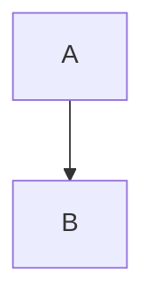

# roam-pele

Draws Mermaid diagrams in Roam Research with [Pele](https://pele.run), a small Mermaid renderer. Diagrams take the full block width and grow to their natural height, and Pele lays them out again when the width changes.

It handles three kinds of diagram:

- `{{[[mermaid]]}}` blocks, drawn by Pele instead of Roam's own renderer.
- A new `{{[[pele]]}}` component.
- Mermaid code blocks, previewed inside the code block.

## `{{[[mermaid]]}}` blocks

Write them as you always have, with the Mermaid source in the child blocks. Pele draws the diagram and Roam's own frame is hidden while Pele's drawing is showing. An Edit button appears at the top right when you hover the diagram, to get back into edit mode.

- Roam still loads and runs mermaid.js behind the hidden frame, so this is **not faster** than before.
- If Pele cannot draw a diagram (for example a syntax Pele does not support), Roam's own drawing is shown instead.
- Block references and autocomplete previews keep Roam's own drawing. The main view, the sidebar and embeds are drawn by Pele.

## `{{[[pele]]}}` blocks

Write them like `{{[[mermaid]]}}`: put the Mermaid source in the child blocks, usually one line per block. Unlike `{{[[mermaid]]}}`, the depth of a nested child becomes Mermaid indentation (2 spaces per level), so a mindmap can be written as an outline:

```
{{[[pele]]}}
  mindmap
    root
      topic A
        detail
      topic B
```

Every line is a block, nested the way Roam nests it. Under `{{[[mermaid]]}}` that nesting is dropped, as in Roam itself.

- With no children, the block shows "Add Mermaid in child blocks".
- If Pele cannot draw the source, Pele's error message is shown in place.
- Roam does not load mermaid.js for `{{[[pele]]}}`.
- Like `{{[[mermaid]]}}`, it creates a `[[pele]]` page reference.
- Without the extension, Roam shows an inert "pele" button and the child blocks stay as they are.
- Inside a block reference or an autocomplete preview, `{{[[pele]]}}` stays Roam's inert "pele" button. Those two places are not decorated for any kind of diagram.

## Mermaid code blocks

A code block whose first line is `mermaid` gets a Pele preview inside the block, above or below the editor (see Settings):

````

````

The preview updates as you type. Code blocks that are the source of a `{{[[mermaid]]}}` or `{{[[pele]]}}` block are not previewed again.

When you leave the editor, Roam rewrites a ```` ```mermaid ```` block to ```` ```javascript ```` and moves `mermaid` to the first line of the body. This is harmless: the preview recognises both forms and keeps working. The extension does not try to prevent it.

## Settings

The "Pele" tab in the extension settings:

| Setting | Default | |
|---|---|---|
| Draw {{[[mermaid]]}} with Pele | on | Turn it off to get Roam's own drawing back for `{{[[mermaid]]}}`. |
| Preview Mermaid code blocks | on | |
| Code block preview position | Above | Above or Below the editor. |

Changes apply without reloading. Disabling the extension also restores Roam's own drawing. `{{[[pele]]}}` has no switch.

## Commands

- Slash command "Pele diagram" inserts `{{[[pele]]}}`.
- Command palette "Pele: convert to {{[[pele]]}}" and "Pele: convert to {{[[mermaid]]}}" replace the first `{{mermaid}}` or `{{pele}}` token in the block you are editing (cursor in the block) with the other component. They do nothing when no block is being edited. They change only that token and leave the rest of the block and its children alone. The drawing looks the same after converting, because Pele draws both kinds; the difference is that `{{[[pele]]}}` skips mermaid.js and keeps indentation, while converting to `{{[[mermaid]]}}` drops the meaning of nested indentation.

## Notes and limits

- Pele lays diagrams out differently from mermaid.js, so a diagram will not look the same as Roam's own drawing.
- Pele ignores Mermaid themes (`%%{init: {theme}}%%`, `--mermaidjs-theme`). `style` and `classDef` colours still apply.
- Pele targets Mermaid 12.1.0 syntax, while Roam ships mermaid 11.4.1, so a diagram can work in one and not the other. For `{{[[mermaid]]}}`, Roam's own drawing is then shown.
- Colours follow Roam's light palette, and dark colours are set for the `bp3-dark`, `rs-dark`, `rm-dark-theme` and `roamjs-custom-dark-theme` classes. There is no other dark mode detection.
- The extension relies on Roam's undocumented page structure and may need updating when Roam changes it.
- Not supported: dragging to resize, Roam's fullscreen button, zoom and export.
- Phone app: not verified. The checks so far were done in the Roam web app in Chrome.

## Privacy

The extension makes no network requests of its own and loads no remote code. What you write in a diagram can still point outside the graph: an image URL in a Mermaid image shape (for example `A@{ img: "https://…" }`) is loaded by the browser when the diagram is drawn, for everyone who opens the page with the extension on, and `click` links in a diagram open when clicked (`javascript:` links are blocked). It never writes to your pages or blocks, except when you run one of the two convert commands. It stores its own three settings with the graph.

## Bundled dependency

[`pele@1.6.0`](https://www.npmjs.com/package/pele) (MIT), bundled into `extension.js`. Pele ships minified only (its `dist/pele.js` is about 678 KB). The build prints it again with line breaks but keeps its short names, so after `npm run build` Pele takes about 934 KB of the 953 KB `extension.js` (about 287 KB gzipped). The extension's own code is the other 19 KB or so, readable and unminified (source in `src/`).

## License

roam-pele is MIT licensed, Copyright (c) 2026 sungjin (see `LICENSE`).

The bundled Pele is MIT licensed, Copyright (c) 2026 kepano, and contains one Lucide icon under the ISC License. A one-line attribution is kept at the top of `extension.js`. Pele's licence in full:

```
MIT License

Copyright (c) 2026 kepano

Permission is hereby granted, free of charge, to any person obtaining a copy
of this software and associated documentation files (the "Software"), to deal
in the Software without restriction, including without limitation the rights
to use, copy, modify, merge, publish, distribute, sublicense, and/or sell
copies of the Software, and to permit persons to whom the Software is
furnished to do so, subject to the following conditions:

The above copyright notice and this permission notice shall be included in all
copies or substantial portions of the Software.

THE SOFTWARE IS PROVIDED "AS IS", WITHOUT WARRANTY OF ANY KIND, EXPRESS OR
IMPLIED, INCLUDING BUT NOT LIMITED TO THE WARRANTIES OF MERCHANTABILITY,
FITNESS FOR A PARTICULAR PURPOSE AND NONINFRINGEMENT. IN NO EVENT SHALL THE
AUTHORS OR COPYRIGHT HOLDERS BE LIABLE FOR ANY CLAIM, DAMAGES OR OTHER
LIABILITY, WHETHER IN AN ACTION OF CONTRACT, TORT OR OTHERWISE, ARISING FROM,
OUT OF OR IN CONNECTION WITH THE SOFTWARE OR THE USE OR OTHER DEALINGS IN THE
SOFTWARE.

---

The reset icon of the zoom controls is "rotate-ccw" from Lucide v1.14.0
(https://lucide.dev), under the ISC License:

Copyright (c) 2026 Lucide Icons and Contributors

Permission to use, copy, modify, and/or distribute this software for any
purpose with or without fee is hereby granted, provided that the above
copyright notice and this permission notice appear in all copies.

THE SOFTWARE IS PROVIDED "AS IS" AND THE AUTHOR DISCLAIMS ALL WARRANTIES
WITH REGARD TO THIS SOFTWARE INCLUDING ALL IMPLIED WARRANTIES OF
MERCHANTABILITY AND FITNESS. IN NO EVENT SHALL THE AUTHOR BE LIABLE FOR
ANY SPECIAL, DIRECT, INDIRECT, OR CONSEQUENTIAL DAMAGES OR ANY DAMAGES
WHATSOEVER RESULTING FROM LOSS OF USE, DATA OR PROFITS, WHETHER IN AN
ACTION OF CONTRACT, NEGLIGENCE OR OTHER TORTIOUS ACTION, ARISING OUT OF
OR IN CONNECTION WITH THE USE OR PERFORMANCE OF THIS SOFTWARE.
```

## Development

```
npm install
npm test
npm run build
npm run serve
```

`npm run serve` serves the build on `http://localhost:8765`. In Roam, turn on developer mode in Roam Depot and load the extension from that URL (not yet verified).
